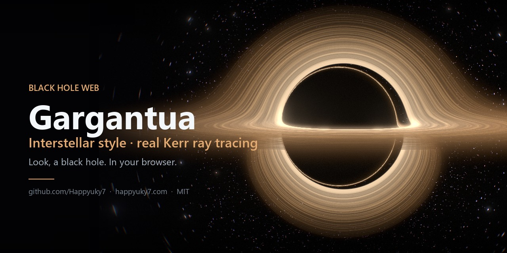
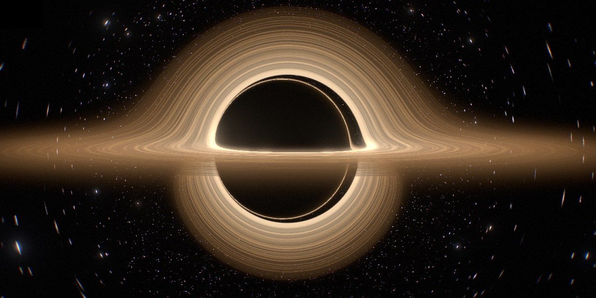
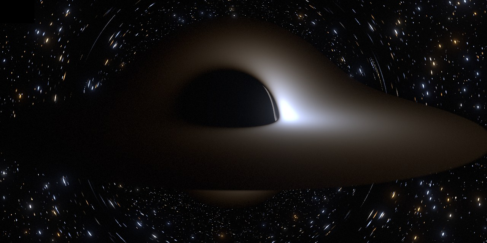
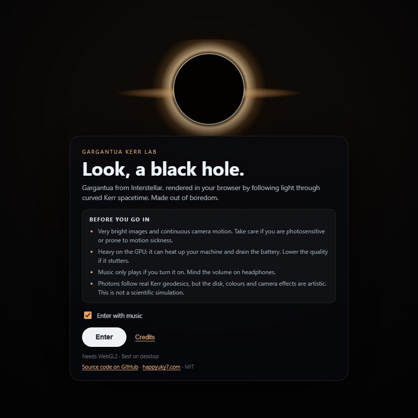
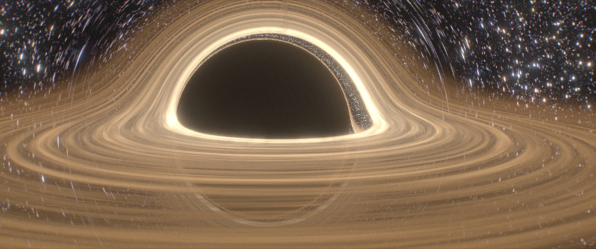
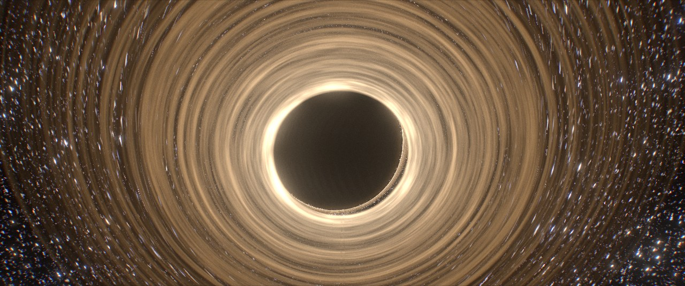

<div align="center">



# Black Hole Web · Interstellar Style

**Look, a black hole.**

Gargantua from *Interstellar*, ray-traced through real Kerr spacetime, live in your browser.

[](https://github.com/Happyuky7/Black-Hole-Web-Interstellar-Style/releases)
[](LICENSE)
[](https://threejs.org)
[](https://caniuse.com/webgl2)
[](#docker)
[](#languages)

[**Official repository**](https://github.com/Happyuky7/Black-Hole-Web-Interstellar-Style) · [**Author's website**](https://happyuky7.com/) · [**The physics**](docs/PHYSICS.md)

</div>

---

## What is this?

A side project made out of boredom that got a bit out of hand.

Every pixel on screen shoots a photon **backwards** from the camera and follows it through the curved, spinning spacetime of a Kerr black hole. Along the way it may hit the accretion disk, fall through the horizon, or escape to the stars. Nothing is faked with a texture of a ring: the shadow, the lensed arc over the top, the thin photon ring and the warped starfield all come out of the equations.

There are two ways to look at it:

- **Artistic modes** recreate the look of the movie: golden disk, no Doppler asymmetry, film grain, anamorphic flare, 2.39:1.
- **Scientific mode** turns all of that off and renders what a camera would actually record. It uses a Novikov–Thorne disk whose temperature comes from the black hole's mass and accretion rate, real blackbody colours, exact Doppler and gravitational redshift, limb darkening, and a 4th-order integrator.

| Cinema mode (the film's camera) | Scientific mode (full physics) |
|---|---|
|  |  |

| Start screen | Free flight near the disk | From below the disk |
|---|---|---|
|  |  |  |

## Features

- **Exact Kerr light paths.** Null geodesics are integrated per pixel on the GPU (leapfrog or RK4), with smooth turning points and constraint projection.
- **Scientific mode**, which includes:
  - a Page–Thorne thin-disk flux with a real temperature set by mass and Eddington ratio;
  - blackbody spectra mapped to colour through the CIE 1931 curves;
  - $g = E_F / u^t(1-\Omega\lambda)$ redshift with $g^4$ beaming;
  - Chandrasekhar limb darkening;
  - blue-shifted starlight at the camera;
  - live readouts of $T_{\max}$, efficiency, $L$ and $\dot M$.
- **Free 3D camera.** Orbit above or below the disk, or switch to free flight (WASD) right up to the photon sphere. The camera is a proper local observer (ZAMO) anywhere outside the horizon.
- **Five presets:**
  - *Interstellar*: the movie look;
  - *Cinema*: the film's exact camera on a black sky;
  - *Scientific*: full physics;
  - *Clean Kerr*: honest Doppler with the movie-style disk;
  - *Edge-on*: near-extremal spin seen from the disk plane.
- **Procedural deep sky**, lensed: sharp stars, a galactic band, faint nebulae and distant galaxies. You can also pick a black "film" sky or a Milky Way photo.
- **Music player.** Play/pause, loop, volume and fade-in. The soundtrack is **downloaded automatically** on first run; see [Music](#music).
- **"The physics" page** inside the app (`/physics`). It derives every equation step by step, from the Kerr metric to the colour of a pixel, rendered with LaTeX (KaTeX, bundled for offline use). Available in English and Spanish.
- **8 languages**, a start screen with warnings and credits, **4K capture**.
- **Error handling.** If the GPU loses its context, a shader fails to compile or anything else crashes, you get a friendly message and an automatic redirect back to the start screen.
- **Production ready.** A zero-dependency Node server (range requests, caching, `/healthz`), a Docker image, and a static build that works on any host.

## Quick start

You need **Node.js 20+** and **pnpm** (`corepack enable` gives you pnpm).

```bash
git clone https://github.com/Happyuky7/Black-Hole-Web-Interstellar-Style.git
cd Black-Hole-Web-Interstellar-Style
pnpm install
pnpm dev            # → http://localhost:5173
```

Production build served by the bundled Node server:

```bash
pnpm build
pnpm serve          # → http://localhost:4173
```

### Docker

```bash
docker compose up --build        # → http://localhost:4173
```

Or with plain Docker:

```bash
docker build -t black-hole-web .
docker run --rm -p 4173:4173 black-hole-web
```

The build is two-stage. The final image is only Node, `dist/` and `server.mjs`, runs as a non-root user and has a healthcheck on `/healthz`. The build stage tries to fetch the soundtrack; pass `--build-arg FETCH_MUSIC=0` to skip that.

### SEO and social previews

Canonical URLs, Open Graph/Twitter cards (the preview Discord, WhatsApp, X and others show), structured data, `robots.txt` and `sitemap.xml` all use the public domain set at build time:

```bash
SITE_URL=https://your.domain pnpm build      # default: https://gargantua.happyuky7.com
```

With Docker, set `SITE_URL` under `build.args` in `docker-compose.yml`. After deploying, submit `https://your.domain/sitemap.xml` in [Google Search Console](https://search.google.com/search-console).

### Static hosting

`pnpm build` outputs a fully static `dist/` with relative paths. It works on GitHub Pages, Netlify, an nginx/Caddy vhost on a VPS, or anything else that serves files. `dist/404.html` redirects lost visitors back to the start screen.

## Music

The player plays Hans Zimmer's *Interstellar – Main Theme* from `public/audio/interstellar-main-theme.mp3`.

The track is copyrighted, so **it is not part of this repository**. Instead, `pnpm dev` and `pnpm build` run [`scripts/fetch-music.mjs`](scripts/fetch-music.mjs), which downloads it **on your machine** the first time with [yt-dlp](https://github.com/yt-dlp/yt-dlp) and [ffmpeg](https://ffmpeg.org):

```bash
yt-dlp -x --audio-format mp3 --audio-quality 0 --embed-thumbnail --embed-metadata \
  https://www.youtube.com/watch?v=dLxja_YEUVw
```

How the script behaves:

- If yt-dlp or ffmpeg is missing, it prints a hint and the app runs without music. It never breaks the build.
- You can drop `yt-dlp(.exe)` and `ffmpeg(.exe)` in the project root instead of installing them.
- Run it by hand with `pnpm music`. Skip it with `SKIP_MUSIC=1`. Use another binary with `YTDLP=/path/to/yt-dlp` or another source with `MUSIC_URL=…`.
- `*.mp3` is git-ignored, so the file can't be committed by accident. Please respect the rights holders when you deploy publicly.

**No sound?**

- Check that the player doesn't say *"Music not found"*. If it does, run `pnpm music` or drop the mp3 in `public/audio/`.
- Some browsers block audio until you interact with the page. If music was blocked when you entered, your next click or key press starts it.
- Check that the volume slider isn't at 0 and that the browser tab isn't muted.
- **Docker on a VPS:** YouTube often blocks downloads from datacenter IPs, so the image may have no soundtrack. Put the file at `./music/interstellar-main-theme.mp3` next to `docker-compose.yml` and it is served from there (mounted at `/music`, read by `AUDIO_DIR`). No rebuild is needed.

## Controls

| | Orbit mode (default) | Free flight (`V`) |
|---|---|---|
| Mouse drag | Orbit around the hole, above or below the disk | Look around |
| Wheel | Zoom in / out | Field of view |
| Shift + wheel | Field of view | n/a |
| Keys | n/a | `WASD` / arrows to move, `Q`/`E` down/up, `Shift` fast |

Global keys: **H** hides the UI, **M** toggles the music, **V** switches orbit ↔ flight.

If it stutters, set **Quality → Fast** or lower **GPU resolution**.

### Presets

| Preset | Physics | Look |
|---|---|---|
| **Interstellar** | Kerr geodesics, a\* = 0.6, Doppler off (as in the film) | Golden textured disk, haze, flare, grain, 2.39:1 |
| **Cinema** | The film's exact camera: r = 74.1 M, θ = 86.6° | Black sky with sparse, distant stars |
| **Scientific** | Everything in [PHYSICS.md](docs/PHYSICS.md): Novikov–Thorne blackbody disk, exact redshift, RK4 | What a camera would really record |
| **Clean Kerr** | a\* = 0.94 with relativistic Doppler beaming | Artistic disk, lopsided brightness |
| **Edge-on** | a\* = 0.998, camera almost in the disk plane | Thin bright band, strong lensing |

In scientific mode, **Mass** and **Accretion rate** really change the disk's temperature, because $T \propto (\lambda_{\text{Edd}}/M)^{1/4}$. A quasar-like $10^8 M_\odot$ at 10 % Eddington glows blue-white at about 120 000 K. Turn the rate down for a golden disk with a dramatic Doppler-boosted side.

## How it works, in one minute

1. **The camera** sits anywhere outside the horizon as a local, non-rotating observer (ZAMO). Each pixel's direction becomes a photon with conserved $\lambda = L_z/E$ and Carter constant $\eta$.
2. **The photon** obeys the separable Kerr equations in Mino time:

   $$(dr/d\sigma)^2 = R(r),\qquad (d\theta/d\sigma)^2 = \Theta(\theta),\qquad d\phi/d\sigma = \lambda/\sin^2\theta - a + aP/\Delta .$$

   The shader integrates the smooth second-order form $r'' = R'/2$, $\theta'' = \Theta'/2$ with leapfrog (artistic) or RK4 (scientific). After each step it projects back onto the null constraint. RK4 is about 7× more accurate at the same cost in steps.
3. **When it crosses the disk**, the gas there orbits at $\Omega = 1/(r^{3/2}+a)$ with a Novikov–Thorne temperature $T(r)$. The photon arrives shifted by $g = E_F/u^t(1-\Omega\lambda)$, and the camera sees a blackbody at $gT$, converted to colour through the CIE curves.
4. **When it escapes**, its direction at infinity picks a star from the procedural sky.
5. **Post-processing**: bloom, then the optional film effects, then ACES tone mapping.

For the full story, open **The physics** from the start screen or the panel (or go to `/physics`). It walks through the derivation step by step, with rendered equations, pointers to the code and the **27 peer-reviewed sources** (DOIs verified against Crossref) that back each formula. The same material, plus the integrator accuracy measurements and references, is in **[docs/PHYSICS.md](docs/PHYSICS.md)**.

## Languages

English · Español · 日本語 · 简体中文 · Français · Deutsch · Português (Brasil) · 한국어

The language is detected from the browser and can be changed on the start screen or in the panel. Translations live in [`src/i18n.js`](src/i18n.js), and adding a language means adding one dictionary.

## Project structure

```
index.html              entry HTML
src/boot.js             start screen, language picker, lazy-loads the renderer
src/main.js             Kerr ray tracer (GLSL), disk physics, post-processing, camera, UI, music
src/i18n.js             translations
src/errors.js           fatal-error screen + automatic redirect to the start screen
src/credits.js          credits dialog
physics.html            "The physics" page (step-by-step derivation)
src/physics/            page script, styles and content (en.js, es.js) rendered with KaTeX
src/style.css           styles
scripts/fetch-music.mjs downloads the soundtrack locally with yt-dlp
server.mjs              zero-dependency static server (ranges, redirects, caching, /healthz)
public/                 static files (optional sky photo, 404 redirect, audio slot)
docs/                   banner, screenshots, PHYSICS.md
Dockerfile, docker-compose.yml
```

## Contributing

Issues and pull requests are welcome, especially new translations, performance tricks for slower GPUs, and physics improvements (returning radiation, a camera on an orbit, polarisation…). Keep the scientific mode honest: if something is an approximation, say so in [PHYSICS.md](docs/PHYSICS.md).

## Credits

- **Physics and visual reference:** O. James, E. von Tunzelmann, P. Franklin & K. S. Thorne, [*Gravitational lensing by spinning black holes in astrophysics, and in the movie Interstellar*](https://arxiv.org/abs/1502.03808) (2015). Also Page & Thorne (1974), Novikov & Thorne (1973), Bardeen, Press & Teukolsky (1972), Carter (1968), and Chandrasekhar (1960). Full list in [PHYSICS.md](docs/PHYSICS.md#11-references).
- **Software:** [Three.js](https://threejs.org) (MIT), [KaTeX](https://katex.org) (MIT) and [Vite](https://vite.dev) (MIT).
- **Music:** *Interstellar – Main Theme* by Hans Zimmer (© its rights holders). It is not distributed; it is downloaded locally by the user.
- **Film:** *Interstellar* (2014), directed by Christopher Nolan. This is a fan project with no affiliation to Warner Bros., Paramount, Legendary or Syncopy.

## Citation

If you use the renderer or its physics write-up in a class, a talk or a paper, please cite it. GitHub's **"Cite this repository"** button (from [`CITATION.cff`](CITATION.cff)) gives APA and BibTeX. The in-app page has a **"How to cite this page"** section with ready-to-copy APA 7 and BibTeX for the article itself, dated and versioned.

```bibtex
@software{happyuky7_2026_blackholeweb,
  author  = {Happyuky7},
  title   = {Black Hole Web: Interstellar Style},
  version = {1.0.0},
  date    = {2026-10-09},
  license = {MIT},
  url     = {https://github.com/Happyuky7/Black-Hole-Web-Interstellar-Style}
}
```

## License

[MIT](LICENSE) © 2026 [Happyuky7](https://github.com/Happyuky7)

The license covers the code in this repository. It does not cover the soundtrack or the film it pays homage to.

## Author

Made by **Happyuky7**

- Website: [happyuky7.com](https://happyuky7.com/)
- GitHub: [@Happyuky7](https://github.com/Happyuky7)
- X / Twitter: [@Happyuky7](https://x.com/Happyuky7)

If you enjoyed looking at a black hole for way longer than planned, a ⭐ on the [repo](https://github.com/Happyuky7/Black-Hole-Web-Interstellar-Style) is appreciated.

<div align="center">

**Happy Coding!** 🚀

</div>
